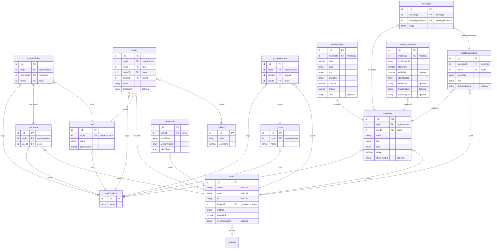

# Schema

Generated from `packages/backend/convex/schema.ts` by `tools/schema-diagram.ts`. Update it with `pnpm --filter @meetings/backend test -u`.

## Indexes

| Table | Index | Fields |
| --- | --- | --- |
| members | by_org_and_user | orgId, userId |
| members | by_user | userId |
| roles | by_org_and_name | orgId, name |
| memberRoles | by_member_and_role | memberId, roleId |
| memberRoles | by_role | roleId |
| tokens | by_value | value |
| tokens | by_expiresAt | expiresAt |
| invites | by_org | orgId |
| invites | by_token | tokenId |
| invites | by_org_and_email | orgId, email |
| groups | by_org | orgId |
| groupMembers | by_group_and_user | groupId, userId |
| groupMembers | by_org_and_user | orgId, userId |
| meetings | by_org_and_user_and_title | orgId, userId, title |
| meetings | by_rtk_meeting | rtkMeetingId |
| meetings | by_code | code |
| meetingTimes | by_meeting | meetingId |
| meetingTimes | by_date | date |
| meetingMembers | by_meeting_and_user | meetingId, userId |
| meetingMembers | by_user | userId |
| meetingSessions | by_meeting | meetingId |
| meetingSessions | by_rtk_session | rtkSessionId |
| messages | by_meeting | meetingId |
| schedules | by_user | userId |
