# Schema

Generated from `packages/backend/convex/schema.ts` by `tools/schema-diagram.ts`. Update it with `pnpm --filter @meetings/backend test -u`.

```mermaid
erDiagram
  users {
    id _id PK
    string name "optional"
    string email "optional"
    string bio "optional"
    id imageId FK "_storage, optional"
    enum method
    boolean isVerified
    string seenTimeZone "optional"
  }
  userSettings {
    id _id PK
    id userId FK "users"
    enum theme
    boolean joinMuted
    boolean joinCameraOff
    enum defaultKind
    number defaultMinutes
    boolean defaultRecap
    boolean autoRecord
    enum invitesFrom
    id activeOrgId FK "organizations, optional"
  }
  organizations {
    id _id PK
    string name
    string joinDomain "optional"
    id joinRoleId FK "roles, optional"
  }
  members {
    id _id PK
    id orgId FK "organizations"
    id userId FK "users"
  }
  roles {
    id _id PK
    id orgId FK "organizations"
    string name
    object permissions
  }
  memberRoles {
    id _id PK
    id orgId FK "organizations"
    id memberId FK "members"
    id roleId FK "roles"
  }
  tokens {
    id _id PK
    string value
    number expiresAt
  }
  invites {
    id _id PK
    id orgId FK "organizations"
    id roleId FK "roles"
    id invitedBy FK "users"
    id tokenId FK "tokens"
    string email
    string emailError "optional"
  }
  joinLinks {
    id _id PK
    id orgId FK "organizations"
    id roleId FK "roles"
    id createdBy FK "users"
    id tokenId FK "tokens"
    number maxUses "optional"
    number uses
    number revokedAt "optional"
  }
  auditEvents {
    id _id PK
    id orgId FK "organizations"
    id actorId FK "users"
    enum action
    id targetUserId FK "users, optional"
    string detail "optional"
  }
  groups {
    id _id PK
    id orgId FK "organizations"
    string name
  }
  groupMembers {
    id _id PK
    id orgId FK "organizations"
    id groupId FK "groups"
    id userId FK "users"
  }
  meetings {
    id _id PK
    id orgId FK "organizations"
    id userId FK "users"
    string code
    string title
    enum kind
    boolean recap
    boolean record "optional"
    boolean protected "optional"
    enum access "optional"
    enum inviters "optional"
    string rtkMeetingId "optional"
  }
  meetingTimes {
    id _id PK
    id meetingId FK "meetings"
    number date
    string start
    string end
    string timeZone
    number startsAt
    number endsAt
    string rrule "optional"
  }
  meetingMembers {
    id _id PK
    id meetingId FK "meetings"
    id userId FK "users"
    enum response
    enum role
    string rtkParticipantId "optional"
    number removedAt "optional"
  }
  meetingGuests {
    id _id PK
    id meetingId FK "meetings"
    id userId FK "users"
    id tokenId FK "tokens"
    id invitedBy FK "users, optional"
    string emailError "optional"
  }
  meetingSessions {
    id _id PK
    id meetingId FK "meetings"
    id orgId FK "organizations, optional"
    string rtkSessionId
    number number
    number startedAt
    number endedAt "optional"
    array attendeeIds
    array presentPeers "optional"
    string summary "optional"
    string transcriptUrl "optional"
    string recordingUrl "optional"
    id transcriptId FK "_storage, optional"
    string recordingKey "optional"
    number recordingSeconds "optional"
  }
  messages {
    id _id PK
    id meetingId FK "meetings"
    id meetingMemberId FK "meetingMembers"
    string body
  }
  messageReactions {
    id _id PK
    id messageId FK "messages"
    id meetingId FK "meetings"
    id memberId FK "meetingMembers"
    enum emoji
  }
  strokes {
    id _id PK
    id meetingId FK "meetings"
    string shareId
    id memberId FK "meetingMembers"
    enum color
    array points
  }
  annotationSnapshots {
    id _id PK
    id meetingId FK "meetings"
    id memberId FK "meetingMembers"
    id storageId FK "_storage"
  }
  schedules {
    id _id PK
    id userId FK "users"
    string timeZone
    array weeklyHours
    array alsoShow
  }
  notifications {
    id _id PK
    id userId FK "users"
    enum kind
    string title
    string detail "optional"
    string meetingCode "optional"
    id sessionId FK "meetingSessions, optional"
    id actorId FK "users, optional"
    number readAt "optional"
  }
  users }o--o| _storage : imageId
  userSettings }o--|| users : userId
  userSettings }o--o| organizations : activeOrgId
  organizations }o--o| roles : joinRoleId
  members }o--|| organizations : orgId
  members }o--|| users : userId
  roles }o--|| organizations : orgId
  memberRoles }o--|| organizations : orgId
  memberRoles }o--|| members : memberId
  memberRoles }o--|| roles : roleId
  invites }o--|| organizations : orgId
  invites }o--|| roles : roleId
  invites }o--|| users : invitedBy
  invites }o--|| tokens : tokenId
  joinLinks }o--|| organizations : orgId
  joinLinks }o--|| roles : roleId
  joinLinks }o--|| users : createdBy
  joinLinks }o--|| tokens : tokenId
  auditEvents }o--|| organizations : orgId
  auditEvents }o--|| users : actorId
  auditEvents }o--o| users : targetUserId
  groups }o--|| organizations : orgId
  groupMembers }o--|| organizations : orgId
  groupMembers }o--|| groups : groupId
  groupMembers }o--|| users : userId
  meetings }o--|| organizations : orgId
  meetings }o--|| users : userId
  meetingTimes }o--|| meetings : meetingId
  meetingMembers }o--|| meetings : meetingId
  meetingMembers }o--|| users : userId
  meetingGuests }o--|| meetings : meetingId
  meetingGuests }o--|| users : userId
  meetingGuests }o--|| tokens : tokenId
  meetingGuests }o--o| users : invitedBy
  meetingSessions }o--|| meetings : meetingId
  meetingSessions }o--o| organizations : orgId
  meetingSessions }o--o| _storage : transcriptId
  messages }o--|| meetings : meetingId
  messages }o--|| meetingMembers : meetingMemberId
  messageReactions }o--|| messages : messageId
  messageReactions }o--|| meetings : meetingId
  messageReactions }o--|| meetingMembers : memberId
  strokes }o--|| meetings : meetingId
  strokes }o--|| meetingMembers : memberId
  annotationSnapshots }o--|| meetings : meetingId
  annotationSnapshots }o--|| meetingMembers : memberId
  annotationSnapshots }o--|| _storage : storageId
  schedules }o--|| users : userId
  notifications }o--|| users : userId
  notifications }o--o| meetingSessions : sessionId
  notifications }o--o| users : actorId
```

## Indexes

| Table | Index | Fields |
| --- | --- | --- |
| users | by_email | email |
| userSettings | by_user | userId |
| organizations | by_join_domain | joinDomain |
| members | by_org_and_user | orgId, userId |
| members | by_user | userId |
| roles | by_org_and_name | orgId, name |
| memberRoles | by_member_and_role | memberId, roleId |
| memberRoles | by_role | roleId |
| tokens | by_value | value |
| tokens | by_expiresAt | expiresAt |
| invites | by_org | orgId |
| invites | by_token | tokenId |
| invites | by_org_and_email | orgId, email |
| joinLinks | by_org | orgId |
| joinLinks | by_token | tokenId |
| auditEvents | by_org | orgId |
| groups | by_org | orgId |
| groupMembers | by_group_and_user | groupId, userId |
| groupMembers | by_org_and_user | orgId, userId |
| meetings | by_org_and_user_and_title | orgId, userId, title |
| meetings | by_rtk_meeting | rtkMeetingId |
| meetings | by_code | code |
| meetingTimes | by_meeting | meetingId |
| meetingTimes | by_date | date |
| meetingMembers | by_meeting_and_user | meetingId, userId |
| meetingMembers | by_user | userId |
| meetingGuests | by_token | tokenId |
| meetingGuests | by_meeting | meetingId |
| meetingSessions | by_meeting | meetingId |
| meetingSessions | by_meeting_and_number | meetingId, number |
| meetingSessions | by_rtk_session | rtkSessionId |
| meetingSessions | by_org_and_ended | orgId, endedAt |
| messages | by_meeting | meetingId |
| messageReactions | by_message_and_member | messageId, memberId |
| messageReactions | by_meeting | meetingId |
| strokes | by_meeting_and_share | meetingId, shareId |
| annotationSnapshots | by_meeting | meetingId |
| schedules | by_user | userId |
| notifications | by_user | userId |
| notifications | by_user_and_readAt | userId, readAt |
