# Schema

Generated from `packages/backend/convex/schema.ts` by `tools/schema-diagram.ts`. Update it with `pnpm --filter @meetings/backend test -u`.

```mermaid
erDiagram
  users {
    id _id PK
    string name "optional"
    string email "optional"
    string bio "optional"
    id imageId FK "_storage, optional"
    enum method
    enum agent "optional"
    boolean isVerified
    string seenTimeZone "optional"
  }
  verifiedSessions {
    id _id PK
    string sessionId
  }
  userSettings {
    id _id PK
    id userId FK "users"
    enum theme
    boolean joinMuted
    boolean joinCameraOff
    enum defaultKind
    number defaultMinutes
    boolean defaultRecap
    boolean autoRecord
    enum invitesFrom
    id activeOrgId FK "organizations, optional"
  }
  organizations {
    id _id PK
    string name
    string joinDomain "optional"
    id joinRoleId FK "roles, optional"
  }
  members {
    id _id PK
    id orgId FK "organizations"
    id userId FK "users"
  }
  roles {
    id _id PK
    id orgId FK "organizations"
    string name
    object permissions
  }
  memberRoles {
    id _id PK
    id orgId FK "organizations"
    id memberId FK "members"
    id roleId FK "roles"
  }
  tokens {
    id _id PK
    string value
    number expiresAt
  }
  invites {
    id _id PK
    id orgId FK "organizations"
    id roleId FK "roles"
    id invitedBy FK "users"
    id tokenId FK "tokens"
    string email
    string emailError "optional"
  }
  joinLinks {
    id _id PK
    id orgId FK "organizations"
    id roleId FK "roles"
    id createdBy FK "users"
    id tokenId FK "tokens"
    number maxUses "optional"
    number uses
    number revokedAt "optional"
  }
  auditEvents {
    id _id PK
    id orgId FK "organizations"
    id actorId FK "users"
    enum action
    id targetUserId FK "users, optional"
    string detail "optional"
  }
  meetings {
    id _id PK
    id orgId FK "organizations"
    id userId FK "users"
    string code
    string title
    string description "optional"
    string location "optional"
    enum kind
    boolean recap
    boolean record "optional"
    boolean liveTextOff "optional"
    boolean protected "optional"
    enum access "optional"
    enum inviters "optional"
    number slowModeSeconds "optional"
    string rtkMeetingId "optional"
    number endedAt "optional"
  }
  meetingTimes {
    id _id PK
    id meetingId FK "meetings"
    id orgId FK "organizations"
    number date
    string start
    string end
    string timeZone
    number startsAt
    number endsAt
    string rrule "optional"
    number repeatUntil
    number sequence "optional"
  }
  meetingMembers {
    id _id PK
    id meetingId FK "meetings"
    id userId FK "users"
    enum response
    enum role
    string rtkParticipantId "optional"
    string rtkPreset "optional"
    number removedAt "optional"
  }
  meetingGuests {
    id _id PK
    id meetingId FK "meetings"
    id userId FK "users"
    id tokenId FK "tokens"
    id invitedBy FK "users, optional"
    string emailError "optional"
    string deviceId "optional"
  }
  joinRequests {
    id _id PK
    id meetingId FK "meetings"
    id userId FK "users"
    enum status
    id tokenId FK "tokens, optional"
    string deviceId "optional"
  }
  meetingSessions {
    id _id PK
    id meetingId FK "meetings"
    id orgId FK "organizations, optional"
    string rtkSessionId
    number number
    number startedAt
    number endedAt "optional"
    array attendeeIds
    array attendance "optional"
    string summary "optional"
    enum summaryCheck "optional"
    string transcriptUrl "optional"
    string recordingUrl "optional"
    id transcriptId FK "_storage, optional"
    string recordingKey "optional"
    number recordingSeconds "optional"
    number recordingStartedAt "optional"
  }
  callPeers {
    id _id PK
    id sessionId FK "meetingSessions"
    id meetingId FK "meetings"
    id memberId FK "meetingMembers"
    string peerId
    number joinedAt "optional"
    number connectedAt "optional"
    boolean liveText "optional"
  }
  rings {
    id _id PK
    id orgId FK "organizations"
    id meetingId FK "meetings"
    id callerId FK "users"
    id calleeId FK "users"
    enum status
  }
  messages {
    id _id PK
    id meetingId FK "meetings"
    id meetingMemberId FK "meetingMembers"
    string body
    boolean pending "optional"
  }
  messageReactions {
    id _id PK
    id messageId FK "messages"
    id meetingId FK "meetings"
    id memberId FK "meetingMembers"
    enum emoji
  }
  strokes {
    id _id PK
    id meetingId FK "meetings"
    string shareId
    id memberId FK "meetingMembers"
    enum tool "optional"
    enum color
    array points
    string text "optional"
    number removedAt "optional"
  }
  annotationSnapshots {
    id _id PK
    id meetingId FK "meetings"
    id memberId FK "meetingMembers"
    id storageId FK "_storage"
  }
  annotationLocks {
    id _id PK
    id meetingId FK "meetings"
    string shareId
  }
  transcriptLines {
    id _id PK
    id meetingId FK "meetings"
    id memberId FK "meetingMembers"
    string text
    number at
  }
  agentPresence {
    id _id PK
    id meetingId FK "meetings"
    id sessionId FK "meetingSessions"
    id memberId FK "meetingMembers"
    number seenAt
  }
  schedules {
    id _id PK
    id userId FK "users"
    string timeZone
    array weeklyHours
    array alsoShow
  }
  notifications {
    id _id PK
    id userId FK "users"
    enum kind
    string title
    string detail "optional"
    string meetingCode "optional"
    id sessionId FK "meetingSessions, optional"
    id actorId FK "users, optional"
    number readAt "optional"
  }
  usage {
    id _id PK
    string key
    number amount
  }
  rooms {
    id _id PK
    id meetingId FK "meetings"
    id orgId FK "organizations"
    string description
    number people
    boolean waitingRoom "optional"
    number closedAt "optional"
  }
  moderationFlags {
    id _id PK
    id orgId FK "organizations"
    id meetingId FK "meetings"
    id userId FK "users"
    id memberId FK "meetingMembers"
    enum kind
    string reason
    enum action
    record scores
    string body "optional"
    id storageId FK "_storage, optional"
    id reporterId FK "meetingMembers, optional"
    number resolvedAt "optional"
    id resolvedBy FK "users, optional"
  }
  bans {
    id _id PK
    id orgId FK "organizations"
    id userId FK "users"
    string deviceId "optional"
    string reason
    id flagId FK "moderationFlags, optional"
    id bannedBy FK "users, optional"
    number expiresAt "optional"
    number liftedAt "optional"
    id liftedBy FK "users, optional"
  }
  users }o--o| _storage : imageId
  userSettings }o--|| users : userId
  userSettings }o--o| organizations : activeOrgId
  organizations }o--o| roles : joinRoleId
  members }o--|| organizations : orgId
  members }o--|| users : userId
  roles }o--|| organizations : orgId
  memberRoles }o--|| organizations : orgId
  memberRoles }o--|| members : memberId
  memberRoles }o--|| roles : roleId
  invites }o--|| organizations : orgId
  invites }o--|| roles : roleId
  invites }o--|| users : invitedBy
  invites }o--|| tokens : tokenId
  joinLinks }o--|| organizations : orgId
  joinLinks }o--|| roles : roleId
  joinLinks }o--|| users : createdBy
  joinLinks }o--|| tokens : tokenId
  auditEvents }o--|| organizations : orgId
  auditEvents }o--|| users : actorId
  auditEvents }o--o| users : targetUserId
  meetings }o--|| organizations : orgId
  meetings }o--|| users : userId
  meetingTimes }o--|| meetings : meetingId
  meetingTimes }o--|| organizations : orgId
  meetingMembers }o--|| meetings : meetingId
  meetingMembers }o--|| users : userId
  meetingGuests }o--|| meetings : meetingId
  meetingGuests }o--|| users : userId
  meetingGuests }o--|| tokens : tokenId
  meetingGuests }o--o| users : invitedBy
  joinRequests }o--|| meetings : meetingId
  joinRequests }o--|| users : userId
  joinRequests }o--o| tokens : tokenId
  meetingSessions }o--|| meetings : meetingId
  meetingSessions }o--o| organizations : orgId
  meetingSessions }o--o| _storage : transcriptId
  callPeers }o--|| meetingSessions : sessionId
  callPeers }o--|| meetings : meetingId
  callPeers }o--|| meetingMembers : memberId
  rings }o--|| organizations : orgId
  rings }o--|| meetings : meetingId
  rings }o--|| users : callerId
  rings }o--|| users : calleeId
  messages }o--|| meetings : meetingId
  messages }o--|| meetingMembers : meetingMemberId
  messageReactions }o--|| messages : messageId
  messageReactions }o--|| meetings : meetingId
  messageReactions }o--|| meetingMembers : memberId
  strokes }o--|| meetings : meetingId
  strokes }o--|| meetingMembers : memberId
  annotationSnapshots }o--|| meetings : meetingId
  annotationSnapshots }o--|| meetingMembers : memberId
  annotationSnapshots }o--|| _storage : storageId
  annotationLocks }o--|| meetings : meetingId
  transcriptLines }o--|| meetings : meetingId
  transcriptLines }o--|| meetingMembers : memberId
  agentPresence }o--|| meetings : meetingId
  agentPresence }o--|| meetingSessions : sessionId
  agentPresence }o--|| meetingMembers : memberId
  schedules }o--|| users : userId
  notifications }o--|| users : userId
  notifications }o--o| meetingSessions : sessionId
  notifications }o--o| users : actorId
  rooms }o--|| meetings : meetingId
  rooms }o--|| organizations : orgId
  moderationFlags }o--|| organizations : orgId
  moderationFlags }o--|| meetings : meetingId
  moderationFlags }o--|| users : userId
  moderationFlags }o--|| meetingMembers : memberId
  moderationFlags }o--o| _storage : storageId
  moderationFlags }o--o| meetingMembers : reporterId
  moderationFlags }o--o| users : resolvedBy
  bans }o--|| organizations : orgId
  bans }o--|| users : userId
  bans }o--o| moderationFlags : flagId
  bans }o--o| users : bannedBy
  bans }o--o| users : liftedBy
```

## Indexes

| Table | Index | Fields |
| --- | --- | --- |
| users | by_email | email |
| verifiedSessions | by_sessionId | sessionId |
| userSettings | by_user | userId |
| organizations | by_join_domain | joinDomain |
| members | by_org_and_user | orgId, userId |
| members | by_user | userId |
| roles | by_org_and_name | orgId, name |
| memberRoles | by_member_and_role | memberId, roleId |
| memberRoles | by_role | roleId |
| tokens | by_value | value |
| tokens | by_expiresAt | expiresAt |
| invites | by_org | orgId |
| invites | by_token | tokenId |
| invites | by_org_and_email | orgId, email |
| joinLinks | by_org | orgId |
| joinLinks | by_token | tokenId |
| auditEvents | by_org | orgId |
| meetings | by_org_and_user_and_title | orgId, userId, title |
| meetings | by_rtk_meeting | rtkMeetingId |
| meetings | by_code | code |
| meetingTimes | by_meeting | meetingId |
| meetingTimes | by_org_and_repeat_until | orgId, repeatUntil |
| meetingMembers | by_meeting_and_user | meetingId, userId |
| meetingMembers | by_user | userId |
| meetingGuests | by_token | tokenId |
| meetingGuests | by_meeting | meetingId |
| meetingGuests | by_user | userId |
| joinRequests | by_meeting_and_status | meetingId, status |
| joinRequests | by_meeting_and_user | meetingId, userId |
| joinRequests | by_token | tokenId |
| meetingSessions | by_meeting | meetingId |
| meetingSessions | by_meeting_and_number | meetingId, number |
| meetingSessions | by_rtk_session | rtkSessionId |
| meetingSessions | by_org_and_ended | orgId, endedAt |
| meetingSessions | by_recording_started | recordingStartedAt |
| callPeers | by_session_and_peer | sessionId, peerId |
| callPeers | by_meeting_and_member | meetingId, memberId |
| rings | by_callee_and_status | calleeId, status |
| rings | by_meeting_and_caller | meetingId, callerId |
| messages | by_meeting | meetingId |
| messageReactions | by_message_and_member | messageId, memberId |
| messageReactions | by_meeting | meetingId |
| strokes | by_meeting_and_share | meetingId, shareId, removedAt |
| annotationSnapshots | by_meeting | meetingId |
| annotationLocks | by_meeting_and_share | meetingId, shareId |
| transcriptLines | by_meeting_and_at | meetingId, at |
| agentPresence | by_meeting_and_member | meetingId, memberId |
| agentPresence | by_session | sessionId |
| schedules | by_user | userId |
| notifications | by_user | userId |
| notifications | by_user_and_readAt | userId, readAt |
| usage | by_key | key |
| rooms | by_meeting | meetingId |
| rooms | by_org | orgId |
| rooms | by_closed_and_people | closedAt, people |
| moderationFlags | by_org | orgId |
| moderationFlags | by_org_and_user | orgId, userId |
| moderationFlags | by_meeting | meetingId |
| moderationFlags | by_meeting_and_member | meetingId, memberId |
| bans | by_org | orgId |
| bans | by_org_and_user | orgId, userId |
| bans | by_org_and_device | orgId, deviceId |
